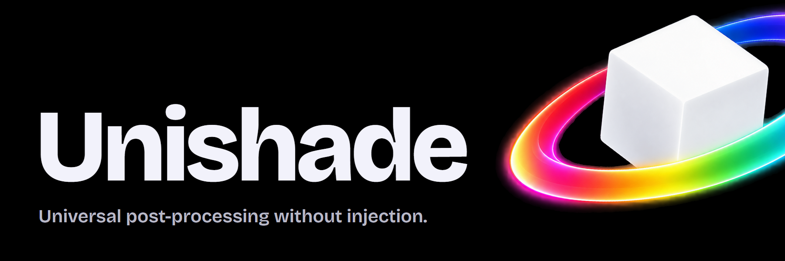
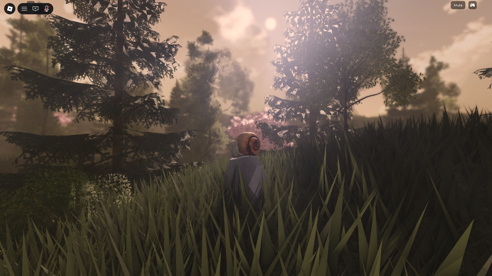
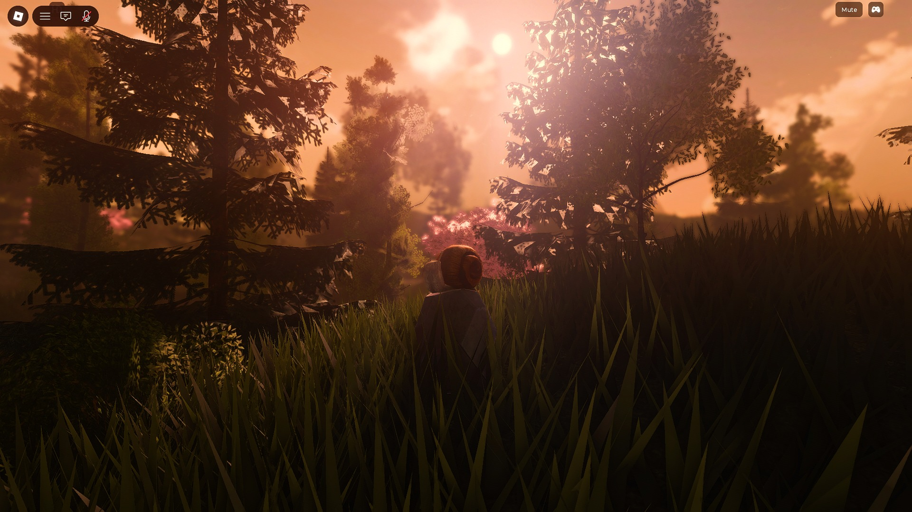
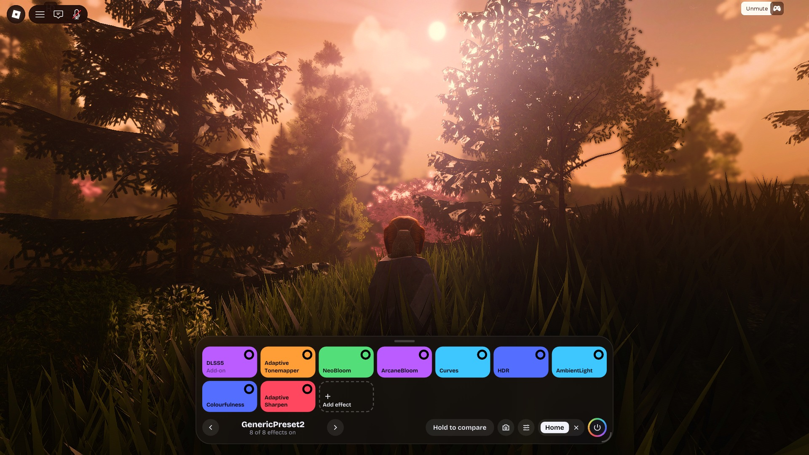
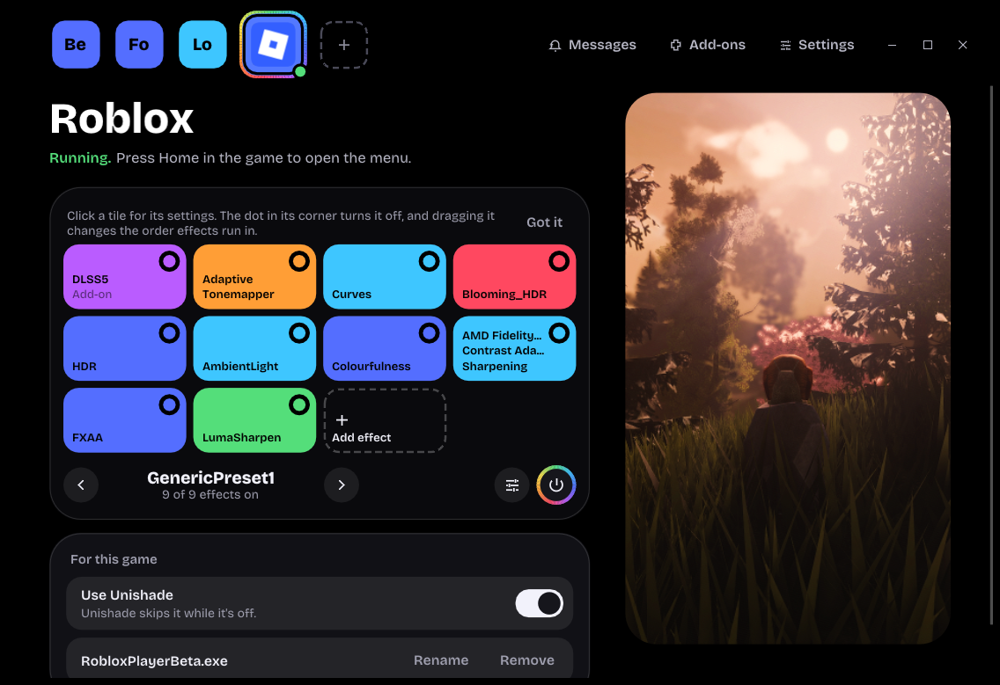

  

<h3 align="center">
  <a href="https://unishade.me/download/">Download</a>
  &nbsp;·&nbsp;
  <a href="https://unishade.me/docs/">Docs</a>
  &nbsp;·&nbsp;
  <a href="https://discord.gg/wVbVUdENas">Discord</a>
</h3>

Run ReShade effects on your games without installing anything into them. Unishade copies the game's window and draws it again with effects, in a window of its own on top. Free and open source, for Windows, macOS and Linux.

<table>
  <tr>
    <td></td>
    <td></td>
  </tr>
  <tr>
    <td align="center">Without Unishade</td>
    <td align="center">With Unishade</td>
  </tr>
</table>

## The menu

Press **Home** in the game, or **Cmd+Shift+U** on a Mac. Every effect is a tile. Click one for its settings, or the dot in its corner to turn it off.

## Your games

Each game gets its own page and starts with the preset you left it on.

  

## Get started

1. [Download Unishade](https://unishade.me/download/) and install it.
2. Start Unishade and pick your games.
3. Open a game and press **Home**.

Run your games in windowed or borderless mode. The [install guide](https://unishade.me/docs/) has every step for Windows, macOS and Linux.

If regular ReShade already works in your game, use that.

> [!WARNING]
> Only download Unishade from [unishade.me](https://unishade.me) or this repository. The unrelated united-debug/unishade repository isn't part of this project.

## Help

[Troubleshooting](https://unishade.me/docs/troubleshooting/) lists what to check when a game isn't picked up or effects don't show. For anything else, ask on [Discord](https://discord.gg/wVbVUdENas). People share their presets there too.

## Building and contributing

See [CONTRIBUTING.md](CONTRIBUTING.md).

## License

[MIT](LICENSE). Unishade is free. If you want to support it, I'm on [Ko-fi](https://ko-fi.com/omouta).
