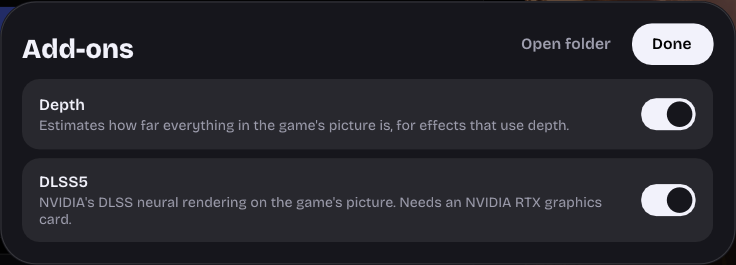
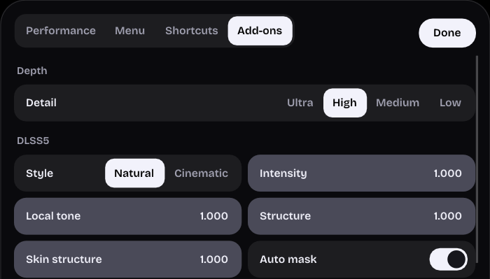

Add-ons work on the game's picture, before effects run or after, and can add settings and controls of their own. **Add-ons** at the top of the Unishade window lists them, each with its version and who made it.

Unishade's own:

- **Depth** estimates how far everything in the picture is. Ambient occlusion, depth of field, fog and other effects that use depth need it. It costs some frame rate. It runs on Windows and on Macs with Apple silicon and macOS 14 or newer.
- **DLSS5** runs NVIDIA's DLSS neural rendering on the picture. It needs Windows and an NVIDIA RTX graphics card.

Unishade's own add-ons come out on their own, apart from Unishade, so a new version of one needs no new Unishade. When you open the Add-ons page, Unishade asks GitHub which ones there are, so the first time it needs a connection to list them.

Click **Install** on one to download it, then use its switch to turn it on or off. When a newer version of an add-on is out, the one you have keeps working and shows **Update**. A beta of Unishade is offered betas of the add-ons too.

## Settings

An add-on that changes the picture, as DLSS5 does, gets a tile in the menu next to the effects. It starts off in every preset: click its dot to turn it on, and the tile for its settings. Each preset keeps both, so a preset you share looks the same for anyone with the add-on.

Depth's detail is saved for your PC, not in the preset.

## Add-ons from other people

**Open folder** opens the Addons folder. Put an add-on's folder there and Unishade asks whether to load it, with the name, version and author the add-on gives. An add-on runs as part of Unishade, so only load ones you trust.

To write one, see [Unishade for developers](/developers/).
