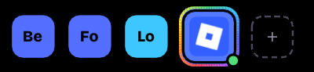
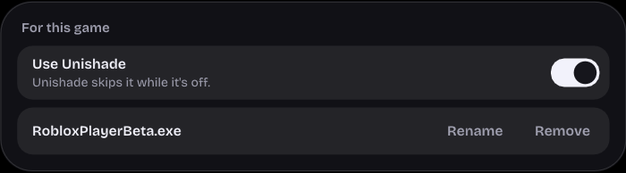
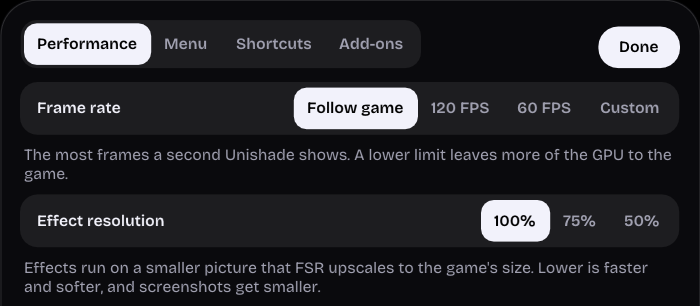

Your games sit on the shelf at the top of the Unishade window. Once a game is there, Unishade starts on it whenever it opens. A green dot marks the one that's running.

## Add a game

1. Open the game, in windowed or borderless mode.
2. Click **+** on the shelf.
3. Pick the game's window.

If the game isn't listed, check that its window isn't minimized. If you move a game to another folder, add it again.

## A game's page

Click a game on the shelf to see its presets. While the game runs, its page also shows the preset's effects, the same as [the menu](/docs/menu/) in the game.

Under **For this game**:

- **Use Unishade** switches the game off without removing it.
- **Rename** changes the name on the shelf.
- **Remove** takes it off the shelf. **Undo** puts it back.

## Performance

The sliders button next to the power button opens **Performance**.

- **Frame rate** limits how many frames Unishade shows. A lower limit leaves more of the GPU to the game.
- **Effect resolution**, on Windows, runs effects on a smaller picture and upscales it. Lower is faster and softer.

These are for the game whose page is open. **Settings > Performance** sets them for every game without its own.

## Use a window just once

While Unishade is waiting for a game, **Pick a window** uses any open window without saving it. **Detect automatically** goes back to your saved games.

## Games that don't work

Some games block screen capture or overlays, and those may not work.
