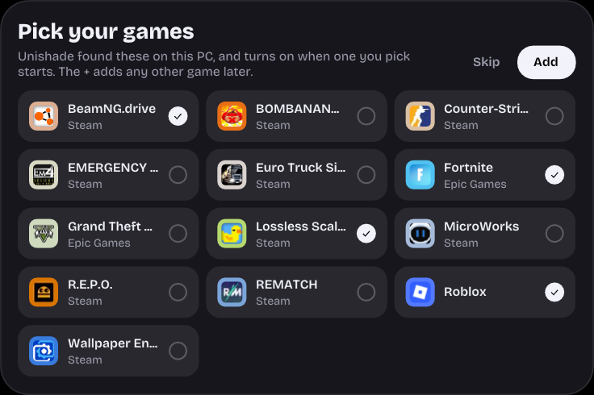
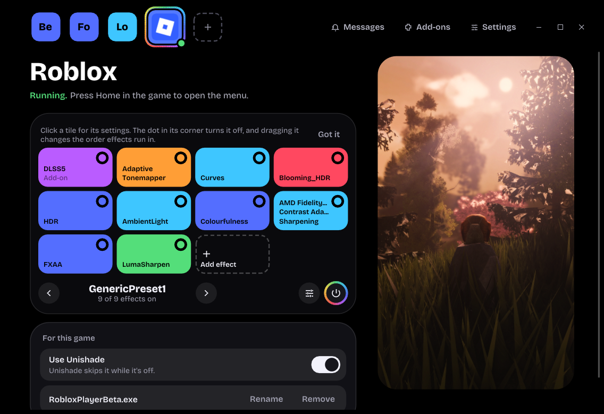
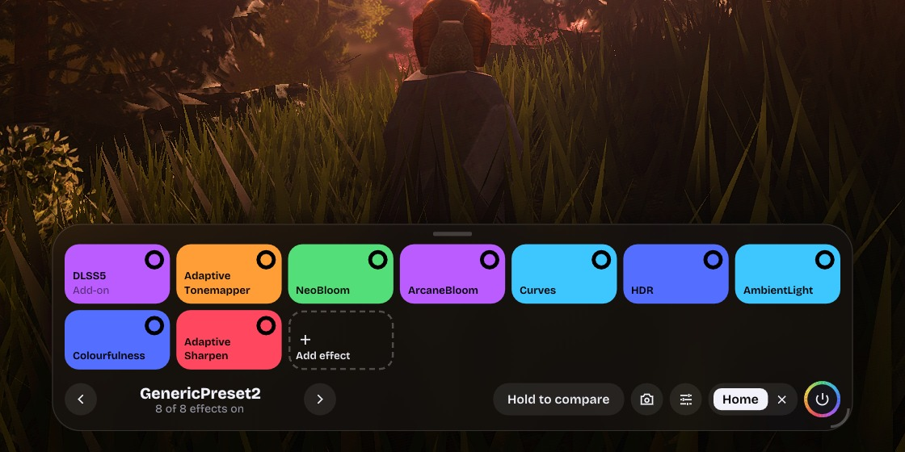

Unishade copies your game's window and draws it again with ReShade effects, in a window of its own on top. Nothing is installed into the game. Run your games in windowed or borderless mode.

Pick your system:

- [Windows](#windows)
- [macOS](#macos)
- [Linux](#linux)

## Windows

You need 64-bit Windows 10 version 2004 or newer, or Windows 11.

1. [Download Setup](/download/#windows) and run it.
2. Setup isn't code-signed yet, so Windows may say **Windows protected your PC**. Click **More info**, then **Run anyway**.
3. Keep the suggested folder, `%LOCALAPPDATA%\Programs\Unishade`, or pick your own. It can't be Roblox's folder.
4. Click **Install**. Setup downloads every official ReShade effect and the Unishade presets.
5. Leave **Start Unishade now** checked and click **Finish**.

Next time, start **Unishade** from the Start menu.

## macOS

You need a Mac with Apple Silicon (M1 or newer) and macOS 13 or newer.

1. [Download Unishade-macOS.zip](/download/#macos), unzip it and move **Unishade** to Applications.
2. The app isn't notarized yet, so macOS stops it the first time:
   - On macOS 15 or newer, open Unishade and click **Done** when macOS says it can't verify it. Open **System Settings > Privacy & Security**, scroll to Security and click **Open Anyway** next to Unishade.
   - On macOS 13 and 14, right-click Unishade and choose **Open**, then click **Open**.
3. Click **Allow screen recording** in Unishade and allow it under **System Settings > Privacy & Security > Screen & System Audio Recording**. On macOS 13 and 14 that's **Screen Recording**.
4. Click **Restart Unishade**. macOS only counts the permission after a restart.
5. Click **Download effects and presets**.

## Linux

You need a 64-bit (x64) PC and a game that draws through X11 or XWayland. Wine and Proton games do. Games that draw to Wayland directly can't be captured.

1. Install the Vulkan driver for your graphics card. Most distributions include it.
2. [Download Unishade-linux-x64.tar.gz](/download/#linux) and unpack it.
3. In the **Unishade** folder it holds, run `./unishade`.
4. Click **Download effects and presets**.

## Pick your games

On Windows, Unishade lists the Steam and Epic games it found the first time it starts. Tick the ones you play and click **Add**.

Each game gets a square on the shelf at the top. The **+** next to them adds any other game: open the game, click **+** and pick its window. That's also how you add games on macOS and Linux.

## Open the menu

Open a game you picked. When Unishade says **Running**, click into the game and press **Home**, or **Cmd+Shift+U** on a Mac.

Each tile is an effect. Click one to change it, or click the dot in its corner to turn it off. [The menu](/docs/menu/) has the rest.

On Windows, closing the Unishade window leaves it running by the clock. To quit, right-click its icon there and choose **Quit**.

## Updating

Install the new version over the old one. Your presets, settings and games stay.

On Windows, Unishade tells you when a new version is out. Turn that off with **Settings > Check for updates**. On macOS and Linux, get new versions from the [download page](/download/).

### Coming from RobloxShadeHost

Unishade is RobloxShadeHost's new name. Run Unishade Setup and it upgrades your install in place, presets and settings included.

## Uninstalling

On Windows, open **Unishade Setup** from the Start menu and choose **Uninstall**. Your presets and settings stay unless you tick the box to delete them.

## Windows without Setup

Put `Unishade.exe` from the [download page](/download/) in a folder of its own and start it. Click **Download effects and presets** when it offers to.
