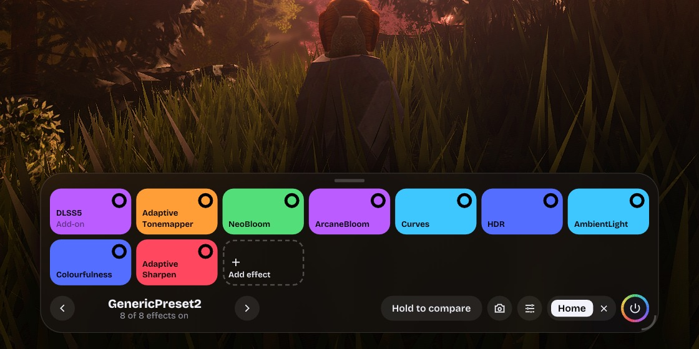
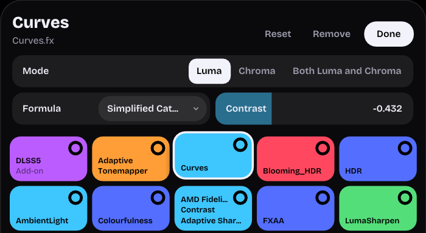
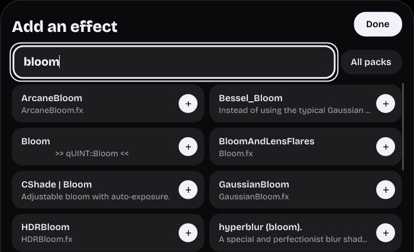
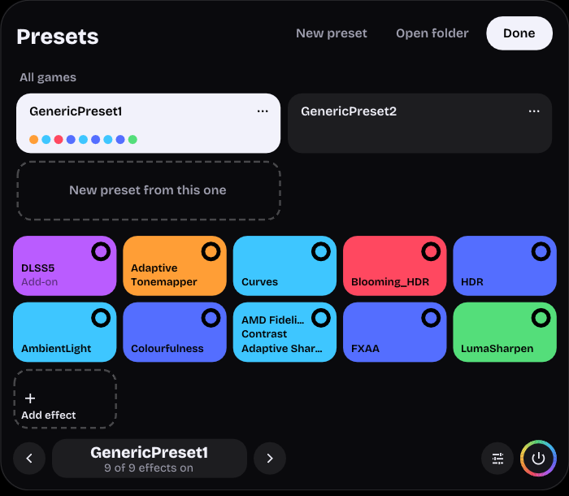
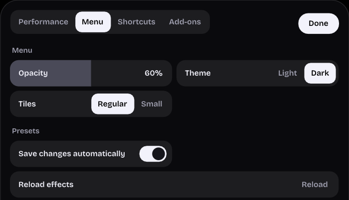
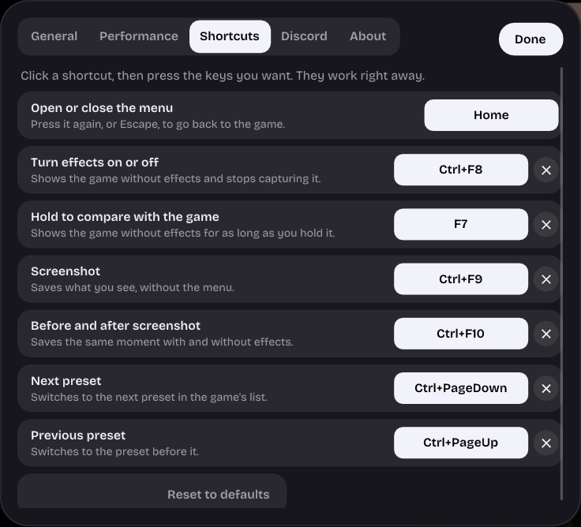

Click into the game and press **Home**, or **Cmd+Shift+U** on a Mac. Press it again, or **Escape**, to go back to playing.

Drag the menu to move it, or to a side of the game to dock it there. Drag its corner to make everything bigger or smaller.

## Effects

Each tile is one effect of the preset.

- Click a tile for its settings.
- Click the dot in its corner to turn it off or on.
- Drag a tile to change the order effects run in.

The round button with the ring turns every effect off and on.

Drag a bar to change a value, or double-click it to type one. Right-click resets it. **Remove** takes the effect out of the preset.

**Add effect** lists every installed effect. Search, or pick a pack, and click **+**.

## Presets

Click the preset's name to see every preset, or use the arrows beside it to step through them. Each game starts with the preset you left it on.

**New preset** starts with every effect off, and **New preset from this one** starts from a copy. The **...** on a preset duplicates, renames, moves or deletes it. Switch to another preset first to rename, move or delete the one in use.

Changes save as you make them. To try changes first, turn off **Save changes automatically** in the menu's settings, then save or discard them yourself.

People share presets on [Discord](links:discord). **Open folder** shows where to put them.

## Compare

Hold **Hold to compare**, or hold **F7** in the game, to see the game without effects.

## Screenshots

The camera button saves a screenshot, without the menu in it. Screenshots go to `Unishade` in your pictures folder.

The sliders button opens the menu's settings, where **Menu** has **Before and after, side by side**, which saves the same moment with and without effects.

## Look

The same **Menu** tab sets the menu's opacity, a light or dark theme and smaller tiles.

## Shortcuts

| Does | Windows and Linux | macOS |
| --- | --- | --- |
| Opens and closes the menu | Home | Cmd+Shift+U |
| Turns effects on or off | Ctrl+F8 | Ctrl+Cmd+O |
| Shows the game without effects while held | F7 | Cmd+Shift+C |
| Saves a screenshot | Ctrl+F9 | Cmd+Shift+P |
| Saves a before and after screenshot | Ctrl+F10 | Cmd+Shift+B |
| Next preset | Ctrl+PageDown | Cmd+Shift+Right |
| Previous preset | Ctrl+PageUp | Cmd+Shift+Left |

To change one, open **Settings > Shortcuts**, click it and press the keys you want. The **×** leaves it without keys.

The shortcut that turns effects on or off works everywhere while Unishade runs. The others only work while the game or the menu is in front, so other programs keep those keys.
